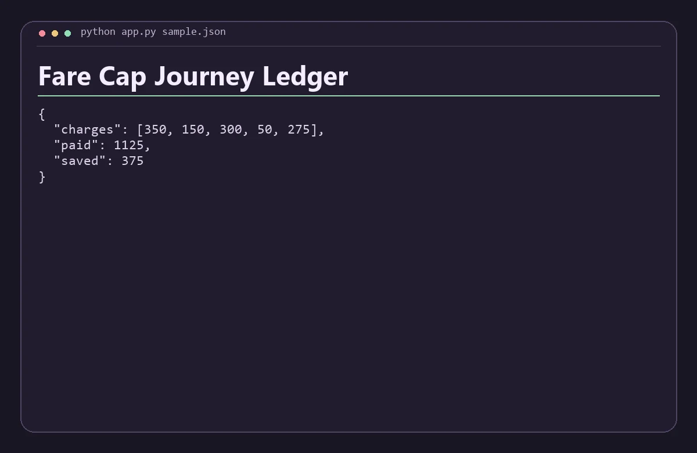

# Fare Cap Journey Ledger

Track the charges on a sequence of rides under configurable daily and weekly fare caps.



## Run

Install Python 3.11 or newer. Run these commands from the repository root.

```sh
python app.py sample.json
```

Replace `sample.json` with a JSON file following the same structure. The app prints a JSON report to standard output.

Use nonnegative amounts in cents and local service dates in YYYY-MM-DD format. Weeks start Monday. Same-day rides keep input order. This models simple caps with no transfer or zone rules.

## Verify

Run `python check.py` with Python 3.11 or newer after the build step when applicable. The check verifies the bundled scenario and confirms that an invalid input returns an error.
